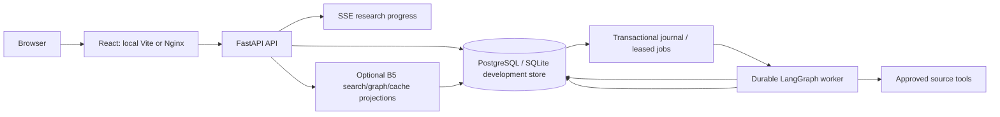

# RhetoriQ

RhetoriQ is an evidence-first narrative investigation system. It detects public
narrative signals, retrieves source material, maps how language changes and
spreads, and produces reports whose material claims point back to inspectable
evidence.

The product distinguishes **first observed in the available dataset** from true
origin and does not treat correlation as proof of coordination.

## Current architecture

The `deployment` branch is the smaller research platform for a permanent
Vercel/Railway deployment. The current runtime uses a PostgreSQL-backed job
queue and one durable worker; the broad Kafka/Flink implementation remains on
`further_dev` for historical reference.



The intended smaller deployment keeps the API, a durable Railway worker, and
managed PostgreSQL. Direct document processing happens inside the worker;
optional B5 stores remain isolated behind a separate overlay.

## What is implemented now

- FastAPI endpoints for ingestion, trending topics, investigations, timelines,
  graphs, mutations, receipts, and reports.
- GDELT, Hacker News, SearXNG, Federal Register, canonical HTTP retrieval, and
  an opt-in isolated browser adapter.
- A bounded LangGraph research runtime with budgets, leases, checkpoints,
  idempotent actions, replay, SSE progress, receipts, and a deterministic
  publication gate.
- Transactional event envelopes retained as PostgreSQL journal records, leased
  database jobs, bounded retries, direct document processing, and LangGraph
  worker execution.
- SQLite development persistence and PostgreSQL/pgvector production persistence.
- A React/TypeScript investigation interface with reports, evidence, timeline,
  graph, audit, and replay views.
- Optional B5 Elasticsearch, Neo4j, MiniLM/pgvector, and Redis projections.

The deployment simplification scope is recorded in
[DEPLOYMENT_SIMPLIFICATION.md](docs/DEPLOYMENT_SIMPLIFICATION.md). The current
branch has removed the unused Kubernetes, Helm, EKS, Terraform, and ECR release
artifacts; the reference branch retains them.

## Research strategy

RhetoriQ is agent-led and source-policy-first:

1. A user question starts a bounded investigation.
2. The planner defines retrieval lanes, source requirements, and uncertainty.
3. Approved tools discover leads or retrieve canonical evidence while preserving
   receipts and limitations.
4. The research runtime builds timelines, source-diversity summaries, narrative
   relationships, counter-frames, provenance, and claim ledgers.
5. A skeptic pass and deterministic evidence gate publish a cited report or an
   explicit `insufficient_evidence` result.

Search snippets and aggregator metadata are discovery leads. Canonical source
captures and approved first-party API records can become citable evidence with
valid receipts. A website, post, transcript, or official record is the source;
an API, feed, search result, or page fetch is the transport.

## Repository layout

```text
rhetoriq/
|-- backend/        # FastAPI, agents, services, models, events, and tests
|-- frontend/       # React, TypeScript, and Vite application
|-- docs/           # Architecture, operations, deployment, and testing records
|-- infra/research/ # SearXNG and isolated browser support
|-- compose.yml     # Local PostgreSQL/SearXNG/API/worker/frontend runtime
|-- SYSTEM_DESIGN.md
`-- README.md
```

## Local development

### Backend

```powershell
cd backend
python -m venv ..\.venv
..\.venv\Scripts\Activate.ps1
pip install -r requirements.txt
uvicorn main:app --reload
```

The API is available at `http://127.0.0.1:8000`; interactive documentation is
at `/docs`.

### Frontend

```powershell
cd frontend
npm install
npm run dev
```

Vite normally serves `http://127.0.0.1:5173`. Routes are `/`, `/dashboard`, and
`/investigation/:id`. Local development uses `VITE_API_BASE_URL`.

### Local stack

The root Compose stack supplies PostgreSQL/pgvector, SearXNG, API, one durable
worker, and frontend. The optional B5 overlay adds Elasticsearch, Neo4j, Redis,
TLS, and pinned MiniLM only when explicitly enabled.

```powershell
$env:POSTGRES_PASSWORD="<local-secret>"
$env:SEARXNG_SECRET="<local-secret>"
docker compose up --build -d
docker compose ps
```

The stack is a local rehearsal for the smaller deployment. It is not proof of
a public Vercel/Railway release.

### Tests

```powershell
pytest backend/tests
cd frontend
npm run build
npm test
```

## Configuration

Settings are authoritative in `backend/config.py` and
`.env.production.example`. Provider credentials belong in environment or
platform secret configuration. Keep optional B5, browser, and vector features
disabled until their dependencies and acceptance evidence exist.

## Documentation

| Document | Purpose |
|---|---|
| [SYSTEM_DESIGN.md](SYSTEM_DESIGN.md) | Product principles and investigation lifecycle. |
| [Architecture](docs/ARCHITECTURE.md) | Current database-queue runtime and target deployment. |
| [Deployment](docs/DEPLOYMENT.md) | Current deployment status, transition boundary, and launch checks. |
| [Simplification plan](docs/DEPLOYMENT_SIMPLIFICATION.md) | Agreed removals, retained capabilities, and acceptance criteria. |
| [Data sources](docs/DATA_SOURCES.md) | Source hierarchy, provider status, and policy. |
| [Operations](docs/OPERATIONS.md) | Compose, database-job, and B5 operations. |
| [Testing](docs/TESTING.md) | Functional checks and database-job acceptance. |
| [Roadmap](docs/ROADMAP.md) | Delivery status and remaining migration work. |
| [Interview](interview.md) | Technical interview prompts and repository-grounded answers. |
