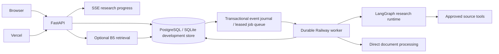

# RhetoriQ Architecture

This document describes the smaller deployment direction on `deployment`.
Kubernetes, Helm, EKS, Terraform, and ECR artifacts remain on the
`further_dev` reference branch. Kafka, Apicurio, and Flink are also reference
architecture there; they are not part of the current Compose topology.

## Design rules

1. Evidence comes before synthesis. Material claims link to retrievable records
   and exact evidence spans.
2. “First observed in the available dataset” is not a claim of true origin.
   Timing, shared language, and graph proximity do not prove coordination.
3. Research is autonomous but bounded by source, time, request, result, model,
   and spending budgets.
4. A source is a publisher, public record, speech, or post. An API, search
   result, feed, or page fetch is the acquisition transport.
5. PostgreSQL is the canonical authority. Derived stores cannot decide citation
   eligibility independently.
6. Failures, gaps, unavailable providers, and degraded reads remain visible.

## Current and target flow

The root Compose stack supplies PostgreSQL/pgvector, SearXNG, API, one durable
worker, and the frontend. The worker claims PostgreSQL jobs with a lease,
renews ownership, processes documents synchronously, and records completion or
bounded retry state. Event envelopes remain useful journal records; no broker
or schema registry is required.

The optional B5 overlay adds Elasticsearch, Neo4j, Redis, TLS, and the pinned
MiniLM runtime for environments that explicitly need those stores. B5 is
derived and optional; the database worker remains the execution boundary.

## Intended permanent deployment

- Vercel serves the React/Vite frontend.
- Railway runs the FastAPI API and a separate durable worker.
- Managed PostgreSQL stores investigations, jobs, checkpoints, events,
  documents, reports, relationships, and radar snapshots.
- A scheduled Railway job refreshes the periodic narrative radar.
- Approved discovery and canonical retrieval tools remain bounded and audited.

## Investigation lifecycle

1. The user submits a question through the React interface.
2. FastAPI validates and persists the plan and accepted job atomically.
3. The worker leases the job and LangGraph selects approved tools for each
   evidence gap.
4. Search results remain discovery leads. Canonical pages or first-party API
   records become evidence only when policy and receipt checks succeed.
5. Fetched documents are normalized and persisted directly in the worker;
   receipts, revisions, withdrawals, and eligibility remain canonical.
6. Deterministic builders produce retrieval, source diversity, timeline,
   narrative family, counterpoint, provenance, gap, and claim-ledger artifacts.
7. The skeptic pass requests a bounded retry or softens unresolved claims.
8. The publication gate stores a cited report or `insufficient_evidence`.
9. Durable progress events feed SSE; the workspace remains reloadable after a
   browser reconnect or API restart.

## Service boundaries

| Boundary | Responsibility |
| --- | --- |
| React/Vercel frontend | Landing, dashboard, progress, reports, evidence, timeline, graph, and audit views. |
| FastAPI/Railway API | Validation, durable reads/writes, health, SSE, and stable API contracts. |
| Database job queue | Atomic accepted work, leases, retries, generation fencing, and terminal status. |
| Railway worker | Bounded LangGraph execution, direct document processing, artifacts, reports, and replay. |
| Research tools | Discovery, public-source retrieval, normalization, and acquisition receipts. |
| PostgreSQL/pgvector | Canonical documents, revisions, receipts, investigations, checkpoints, reports, and journal. |
| Optional B5 stores | Derived lexical, graph, semantic, and cache accelerators; never the authority. |

## Durable research state

The runtime persists plans, runs, budgets, action decisions, candidates,
documents, receipts, checkpoints, ordered stage events, evaluations, reports,
and replay comparisons. Stable action IDs, leased jobs, bounded retries, and
fenced commits limit duplicate work and stale-worker writes.

## Verification boundary

Offline tests establish code behavior. Runtime qualification separately proves
real databases, models, providers, restart recovery, and platform deployment.
Compose rendering is configuration evidence only; it is not proof of a public
Vercel/Railway release.
